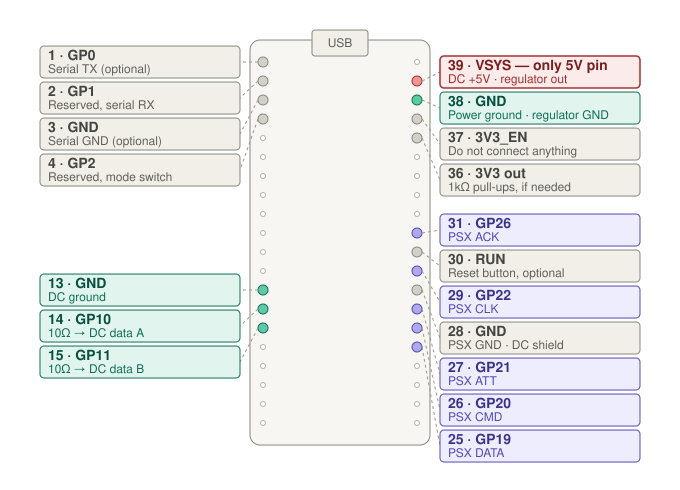
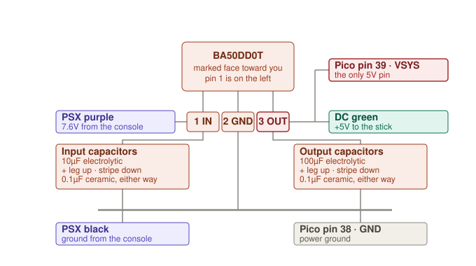
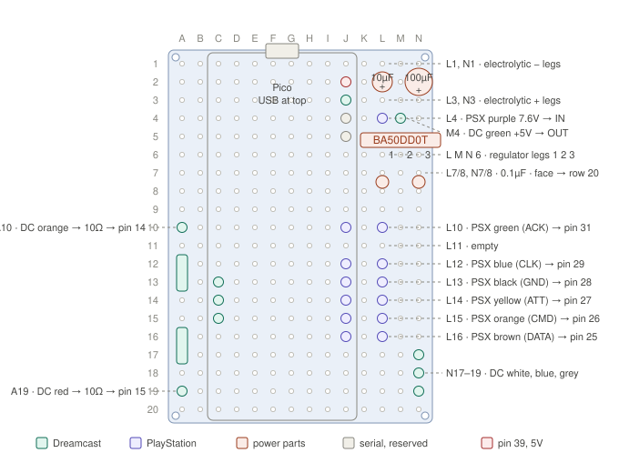
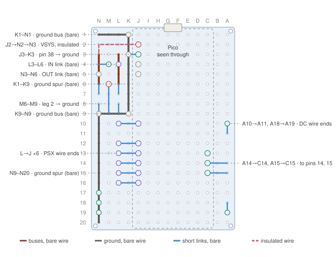

# Pico DC → PS1

Play PlayStation games with a Dreamcast controller or arcade stick.

This is firmware and a hardware build for a Raspberry Pi Pico (RP2040) that
reads a Dreamcast controller over the Maple bus and presents it to a PS1 or PS2
as a standard PlayStation pad. Plug the same adapter into a PC instead and it
becomes a USB gamepad.

It is built on top of [PicoGamepadConverter](https://github.com/Loc15/PicoGamepadConverter)
by Loc15, which provides the PlayStation device emulation, the USB gamepad
modes and the web configuration page. This project adds a Dreamcast (Maple bus)
input mode and fixes to the PS1 side that make it work in the console's own
menu and in games that use the standard pad driver.


[](./docs/media/demo.mp4)

*Click the image above to watch a short demo (25 seconds, no sound).*

---

## Features

- **Dreamcast in, PlayStation out.** Reads a Dreamcast controller or arcade
  stick and presents it as a PS1/PS2 digital pad (or an analog pad if you
  choose that mode).
- **Picks its output automatically** *(untested)*. Powered by the console,
  it acts as a PlayStation pad. Plugged into a PC by USB, it should act as a
  USB gamepad (Xinput by default; other USB modes can be chosen in the web
  configuration page). The code is in place but hasn't been tried on hardware
  yet.
- **Powered by the console.** A 5V regulator runs off the PlayStation port's
  7.6V rail and powers both the Pico and the Dreamcast stick. No external
  power and no USB cable needed in the console.
- **No level shifting.** Both the Maple bus and the PlayStation pad bus are
  3.3V logic, so the Pico's pins connect directly.
- **Digital/analog toggle from the stick.** Hold a button combo to switch which
  PlayStation pad type the console sees.
- **Status LED** showing whether the stick is detected and whether the console
  is reading the adapter.

### Tested

| Where | What | Result |
|---|---|---|
| PS1 (original "fat" model), console-powered | BIOS / startup menu and every game tried, including Soul Edge and King of Fighters '96 | Working, no known issues |
| PC (Xinput) | Super Smash Bros. Melee | Worked before the automatic output switch was added; not retested since |
| Automatic PS1 / USB switch | | Not yet tested |
| Input | Dreamcast arcade stick | Working |

---

## How it works

```
Dreamcast stick ──Maple bus──▶ Pico (RP2040) ──PS1 pad bus──▶ PlayStation
   (GPIO 10/11)                core 0: Maple host              (GPIO 19-22, 26)
                               core 1: PS1 pad emulation
                                      │
                                      └──USB──▶ PC (when plugged in)
```

- **Maple host.** The Pico polls the Dreamcast stick the way a Dreamcast does:
  it asks for device info until the stick answers, then requests the
  controller's state every 1 ms. The Maple layer comes from
  [DreamPicoPort](https://github.com/OrangeFox86/DreamPicoPort). An RP2040 has
  only two PIO blocks, and one is needed for the PS1 side, so the Maple read
  and write programs share the other block and are swapped at each read/write
  handoff. See [`src/host_files/maple_host/README.md`](./src/host_files/maple_host/README.md)
  for the details.
- **PS1 pad emulation.** This is PicoGamepadConverter's PlayStation device
  mode, with two timing fixes for a 240 MHz system clock. The PIO clock
  divider was changed back to the designed 2.5 MHz. The ACK pulse was delayed
  to about 6.4 µs, because the PS1's built-in pad driver ignores an ACK that
  comes too soon. Without that fix, the startup menu and some games ignore the
  adapter while others work.
- **Choosing the output.** At boot the firmware reads GPIO24, which carries
  the Pico's USB VBUS line. No USB power means the Pico is running from the
  console, so it acts as a PS1 pad. USB power means a PC is attached, so it
  uses the USB mode saved in the web configuration page. The console side of
  this is confirmed; the USB side hasn't been tested yet.

---

## Controls

Dreamcast buttons map to the PlayStation pad as follows.

| Dreamcast | PlayStation |
|---|---|
| D-pad | D-pad |
| A | ✕ Cross |
| B | ○ Circle |
| X | □ Square |
| Y | △ Triangle |
| Start | Start |
| L trigger | L2 |
| R trigger | R2 |
| C ¹ | L1 |
| Z ¹ | R1 |
| D ¹ | Select |
| Analog stick | Left stick (analog mode), or D-pad (digital mode) |

¹ C, Z and D aren't on a standard Dreamcast controller, but the protocol
carries them and many arcade sticks wire up six face buttons. Check which of
your stick's buttons send C, Z and D.

### Digital / analog toggle

Hold **A + B + X + Y + Start** for about a third of a second to switch between
a **digital** pad (the default) and an **analog** pad. Release everything
before toggling again.

- **Digital mode** works everywhere, including the PS1 startup menu. Moving
  the analog stick more than about 20% from centre presses the D-pad, so a
  regular Dreamcast controller can play digital-only games.
- **Analog mode** passes the stick to the game as the left analog stick. Some
  titles refuse an analog pad on purpose, just as they refuse a DualShock with
  its analog light on.

### LED

| LED | Meaning |
|---|---|
| Slow blink, about 1 per second | Running, but no Dreamcast stick is answering |
| Groups of blinks with a pause | Stick connected, console reading the adapter. The number of blinks is how many bytes the console read in the last poll: 5 for digital, 9 for analog |
| Solid | Stick connected, but the console isn't reading the adapter |

---

## Hardware

### Parts

- Raspberry Pi Pico (RP2040)
- A PlayStation controller cable (a cut-off DualShock cable works), for the
  plug
- A Dreamcast controller extension cable, for the socket
- ROHM BA50DD0T 5V LDO regulator (TO220FP-3)
- Capacitors: 10 µF and 100 µF electrolytic, 2 × 0.1 µF ceramic
- 2 × 10 Ω resistors (33 Ω as a fallback if the bus is unreliable)
- A 14 × 20 hole double-sided prototyping board (optional; the layout in the
  docs is for this size)

### Pin map



| Pico pin | GPIO | Connects to |
|---|---|---|
| 14 | GPIO10 | Dreamcast Data A (SDCKA), through 10 Ω |
| 15 | GPIO11 | Dreamcast Data B (SDCKB), through 10 Ω |
| 25 | GPIO19 | PSX pin 1, DATA |
| 26 | GPIO20 | PSX pin 2, CMD |
| 27 | GPIO21 | PSX pin 6, ATT / SEL |
| 29 | GPIO22 | PSX pin 7, CLK |
| 31 | GPIO26 | PSX pin 9, ACK |
| 39 | VSYS | Regulator 5V output |
| 13, 28, 38 | GND | Maple ground, PSX signal ground, power ground |

> [!WARNING]
> **Dreamcast pin 2 (+5V) must never touch a GPIO.** It connects only to the
> regulator output and VSYS. The RP2040's pins are not 5V tolerant.
>
> **PSX pin 5 (3.3V from the console) is not used.** Trim it short and
> insulate it properly. A bare wire there can short the console's logic rail.
>
> **Cable colours are not standard.** Three different Dreamcast cables used
> three different colours for +5V. Identify every wire with a meter. Never go
> by colour.

### Power

The PlayStation port supplies 3.3V and 7.6V but no 5V, and a Dreamcast stick
needs 5V. The BA50DD0T regulator drops the console's 7.6V to 5V for the stick
and for the Pico's VSYS pin. Feeding VSYS rather than the 3V3 pin leaves the
console's logic rail alone. It also lets you keep USB plugged in while the
adapter runs in a powered console, which is useful for serial debugging.



### Build photos

| Before wiring | Finished |
|---|---|
|  |  |

The Pico sits on the prototyping board inside a small clear case, with the
PlayStation cable and the Dreamcast extension cable both coming in from the
top.

### Full build documentation

- **[`docs/wiring.md`](./docs/wiring.md)**: every connection, how to identify
  the wires in each cable, the power circuit, grounding, and the checks to do
  before powering on.
- **[`docs/assembly.md`](./docs/assembly.md)**: step-by-step soldering order
  for the prototyping board, with a meter check after each stage.
- **[`docs/board-layout.py`](./docs/board-layout.py)**: generates the board
  diagrams below. If a diagram and the script ever disagree, the script is
  right.

| Component side | Solder side (mirrored) |
|---|---|
|  |  |

---

## Getting started

### 1. Build the firmware

You need the Raspberry Pi Pico SDK toolchain. The SDK, TinyUSB, Pico-PIO-USB
and Mongoose are included as git submodules.

**Linux / macOS**

```bash
git clone --recurse-submodules https://github.com/NenfizCode/Pico-DC-PS1
```

```bash
cd Pico-DC-PS1 && mkdir build && cd build
```

```bash
cmake ../src -DPICO_BOARD=pico && make
```

**Windows**

Install the VS Code *Raspberry Pi Pico* extension and the Visual Studio *Desktop
development with C++* workload, then run this from the repository folder:

```powershell
.\build.ps1
```

Either way, the output is `build/PicoGamepadConverter.uf2`.

### 2. Flash it

Hold **BOOTSEL** while plugging the Pico into a computer, then copy
`PicoGamepadConverter.uf2` onto the `RPI-RP2` drive that appears.

### 3. Set Dreamcast as the input (once)

The input mode is stored in the Pico's flash, so this only needs doing once.

1. Plug the Pico into a computer by USB.
2. Within 3 seconds of powering on, press the **BOOTSEL** button. The LED
   starts blinking and the Pico appears as a USB network adapter.
3. Open <http://192.168.3.1> in a browser.
4. Set **Host** to **Dreamcast**. Set **Device** to the USB mode you want on a
   PC (Xinput is a good default). Click **Save**.

You don't need to pick PS1/PS2 as the Device. The adapter switches to PS1/PS2
on its own whenever it's powered by the console. Switching to the USB mode when
plugged into a PC is implemented but not yet tested.

### 4. Play

With the console **off**, plug the Dreamcast stick into the adapter and the
adapter into controller port 1. Turn the console on. The LED should go from a
slow blink to groups of blinks once the stick is detected and the console is
polling.

Always connect and disconnect with the console off.

---

## Troubleshooting

- **Slow blink never stops.** The stick isn't answering. Check Data A and
  Data B. If they're swapped, the stick is never detected, and swapping them
  back costs nothing because both lines are 3.3V behind 10 Ω. Then check the
  stick's 5V supply.
- **LED solid; the console doesn't respond.** The stick is fine but the
  console isn't reading the adapter. Check the DATA, CMD, ATT, CLK and ACK
  wires and the PSX ground.
- **Some games or the startup menu ignore the adapter, but others work.**
  Make sure you're running this repository's firmware. The ACK timing fix in
  `psxSPI.pio` is what makes the console's own pad driver accept the adapter.
- **A game ignores the stick in analog mode.** Toggle back to digital with
  A + B + X + Y + Start. Some games only accept a digital pad.
- **Unreliable stick input.** Try 33 Ω instead of 10 Ω on the data lines. The
  RP2040's internal pull-ups have been enough so far. If they aren't, add
  1 kΩ from each data line to 3V3 (Pico pin 36).

Avoid having USB plugged in while the adapter is in a console that's switched
**off**. That puts USB voltage on the regulator's output while its input is at
0V. Either unplug from the console when using a PC, or add a 1N5819 Schottky
diode from the regulator's output to its input.

---

## Project layout

| Path | What |
|---|---|
| `src/host_files/maple_host/` | Dreamcast Maple bus host (added by this project) |
| `src/device_files/psx-device/` | PS1/PS2 pad emulation (from PicoGamepadConverter, with the timing fixes) |
| `src/main.c` | Startup, choosing the output by VBUS, the button combo and the LED |
| `src/convert_data.c` | Dreamcast → PlayStation / USB button mapping |
| `src/config.h` | Pin assignments (the PS1 pins are set in `psxSPI.pio`) |
| `docs/` | Wiring, assembly, board layout and diagrams |
| `build.ps1` | Windows build script |

PicoGamepadConverter's other input and output modes (USB, Bluetooth, PS/2
keyboard, N64, GameCube, Wii, Switch) are still in the source and selectable
from the web page, but this project neither tests nor documents them. See the
[original project](https://github.com/Loc15/PicoGamepadConverter) for those.

---

## Acknowledgments

- **[PicoGamepadConverter](https://github.com/Loc15/PicoGamepadConverter)** by
  Loc15. The base this project is built on: PS1/PS2 device emulation, USB
  modes, web configuration and the overall firmware structure.
- **[DreamPicoPort](https://github.com/OrangeFox86/DreamPicoPort)** by
  OrangeFox86, for the Maple bus implementation, by way of the trimmed
  host-only copy in [OGX-Mini-2026](https://github.com/MegaCadeDev/OGX-Mini-2026).
- [PicoMemcard](https://github.com/dangiu/PicoMemcard) by dangiu, for the
  `psxSPI.pio` program.
- [psx-spx](https://psx-spx.consoledev.net/) for the PlayStation controller
  timing details behind the ACK fix.
- PicoGamepadConverter's own dependencies and credits:
  [TinyUSB](https://github.com/hathach/tinyusb),
  [Pico-PIO-USB](https://github.com/sekigon-gonnoc/Pico-PIO-USB),
  [btstack](https://github.com/bluekitchen/btstack),
  [GP2040-CE](https://github.com/OpenStickCommunity/GP2040-CE),
  [DS4toPS2](https://github.com/TonyMacDonald1995/DS4toPS2) and others listed
  in the [original README](https://github.com/Loc15/PicoGamepadConverter#acknowledgments).

## License

[GNU General Public License v3](LICENSE), the same as PicoGamepadConverter. The
Maple bus files taken from DreamPicoPort are MIT licensed, which is compatible
with GPLv3.
