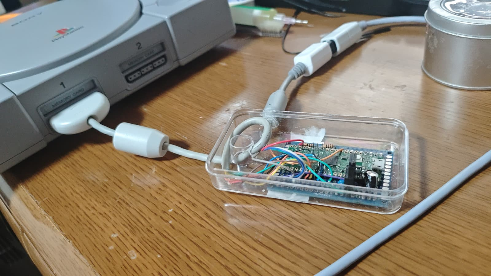
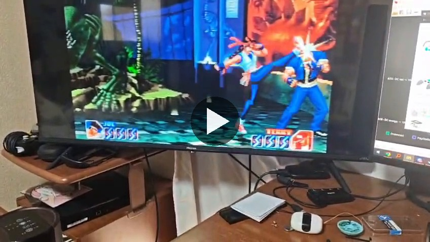
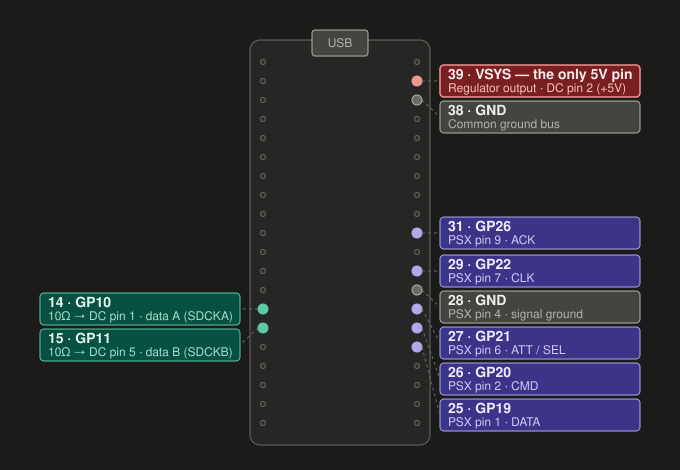
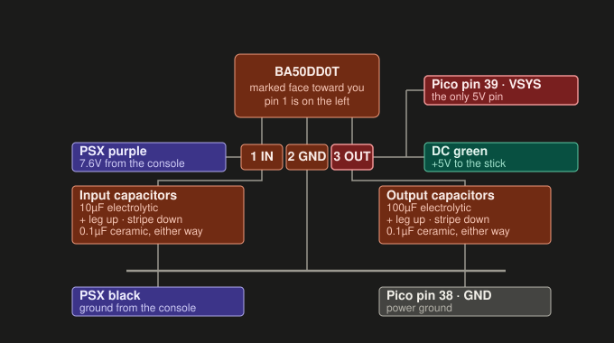
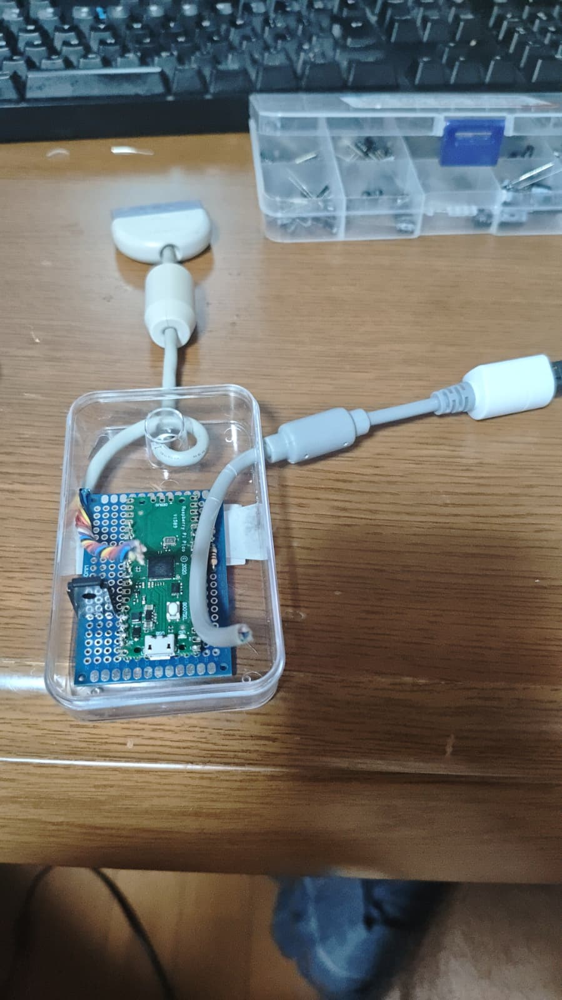

# Pico DC → PS1

A Raspberry Pi Pico adapter that lets you use a Dreamcast controller on a
PlayStation. It also works as a USB controller on a PC.

Based on [PicoGamepadConverter](https://github.com/Loc15/PicoGamepadConverter)
by Loc15, which already had PS1/PS2 controller emulation, USB modes and a web
config page. This adds Dreamcast (Maple bus) input and fixes the PS1 timing so
the BIOS and every game accept it.

> [!NOTE]
> I'm not an electronics or embedded developer and don't have much background
> in this. Everything here was put together by referencing other projects and
> with help from AI as I built it. That said, the finished adapter works as
> described in the wiring and assembly docs.



[](./docs/media/demo.mp4)

---

## Features

- Reads a Dreamcast controller and shows up on a PS1/PS2 as a normal
  digital pad, or an analog pad if you switch modes.
- Runs off the console. A 5V regulator on the PS1's 7.6V line powers the Pico
  and the Dreamcast controller, so no extra power or USB cable is needed.
- No level shifters. The Maple bus and the PS1 pad bus are both 3.3V, so they
  connect straight to the Pico.
- Button combo on the controller to switch between digital and analog.
- Status LED.
- Should switch to USB controller mode on its own when plugged into a PC
  instead of a console. This is written but not tested yet.

### Tested

| Setup | Result |
|---|---|
| PS1 (fat model), powered by the console | BIOS and every game tried work, including Soul Edge and King of Fighters '96 |
| PC over USB (Xinput) | Works. Tested before the auto switch was added |
| Auto switch between PS1 and USB | Not tested yet |

---

## How it works

```
Dreamcast controller ──Maple bus──▶ Pico (RP2040) ──PS1 pad bus──▶ PlayStation
   (GPIO 10/11)                     core 0: Maple host              (GPIO 19-22, 26)
                                    core 1: PS1 pad emulation
                                           │
                                           └──USB──▶ PC
```

**Dreamcast side.** The Pico polls the controller the same way a Dreamcast
does: device info request until it answers, then a condition request every
1 ms. The Maple bus code comes from
[DreamPicoPort](https://github.com/OrangeFox86/DreamPicoPort). The RP2040 only
has two PIO blocks and the PS1 side needs one, so the Maple read and write
programs share the other block and get swapped in and out on every
transaction. More detail in
[`src/host_files/maple_host/README.md`](./src/host_files/maple_host/README.md).

**PS1 side.** PicoGamepadConverter's PS1 controller emulation, with two
changes for the 240 MHz clock: the PIO clock divider is back to the intended
2.5 MHz, and ACK now comes about 6.4 µs after the last clock edge. The PS1 BIOS
pad driver ignores an ACK that arrives sooner.

**PS1 or USB.** At boot the firmware checks GPIO24, which is the Pico's USB
power sense. No USB power means it's running from the console, so it acts as a
PS1 controller. USB power means it's on a PC, so it uses whatever USB mode is
saved in the web config.

---

## Controls

| Dreamcast | PlayStation |
|---|---|
| D-pad | D-pad |
| A | Cross |
| B | Circle |
| X | Square |
| Y | Triangle |
| Start | Start |
| L trigger | L2 |
| R trigger | R2 |
| C | L1 |
| Z | R1 |
| D | Select |
| Analog stick | Left stick in analog mode, D-pad in digital mode |

C, Z and D aren't on the standard Dreamcast controller, but the protocol
supports them and some controllers use them.

### Digital / analog

Hold **A + B + X + Y + Start** for a moment to switch between digital and
analog. Let go of everything before switching again. It always starts in
digital mode at power-up.

In digital mode, pushing the analog stick past about 20% also presses the
D-pad, so you can use the stick in games that only take digital input. In
analog mode the stick goes to the game as the left analog stick. A few games
refuse analog pads entirely, same as with a DualShock in analog mode.

### LED

| LED | Meaning |
|---|---|
| Slow blink | No Dreamcast controller detected |
| Groups of blinks | Controller detected and the console is reading the adapter. 5 blinks = digital, 9 = analog |
| Solid | Controller detected, but the console isn't reading the adapter |

---

## Hardware

### Parts

- Raspberry Pi Pico (RP2040). Not a Pico W: the PS1/USB detection uses
  GPIO24, which the Pico W uses for its wireless chip. Pico 2 hasn't been
  tested.
- PlayStation controller cable (one cut off an old DualShock works)
- Dreamcast controller extension cable, for the socket
- ROHM BA50DD0T 5V regulator (TO220FP-3)
- 10 µF and 100 µF electrolytic capacitors, 2 × 0.1 µF ceramic
- 2 × 10 Ω resistors
- 14 × 20 hole double-sided protoboard (optional, the layout in `docs/` is for
  this size)

### Pin map



| Pico pin | GPIO | Connects to |
|---|---|---|
| 14 | GPIO10 | Dreamcast Data A (SDCKA), through 10 Ω |
| 15 | GPIO11 | Dreamcast Data B (SDCKB), through 10 Ω |
| 25 | GPIO19 | PSX pin 1, DATA |
| 26 | GPIO20 | PSX pin 2, CMD |
| 27 | GPIO21 | PSX pin 6, ATT |
| 29 | GPIO22 | PSX pin 7, CLK |
| 31 | GPIO26 | PSX pin 9, ACK |
| 39 | VSYS | Regulator 5V output |
| 28, 38 | GND | PSX ground, common ground (any Pico GND pin works) |

> [!WARNING]
> Dreamcast pin 2 is +5V. Keep it away from every GPIO, it only goes to the
> regulator output and VSYS. The RP2040 isn't 5V tolerant.
>
> PSX pin 5 is the console's 3.3V line and isn't used. Cut it short and
> insulate it, or it can short the console.
>
> Identify every wire with a multimeter before soldering. Cables differ, so
> don't rely on anyone else's wiring notes for which wire is which.

### Power

The PS1 controller port has no 5V line, so the BA50DD0T makes 5V from the
console's 7.6V for the controller and the Pico's VSYS pin. Details in
[`docs/wiring.md`](./docs/wiring.md#power).



### Build photos

| Before wiring | Finished |
|---|---|
|  |  |

### Build docs

- [`docs/wiring.md`](./docs/wiring.md): every connection, how to work out
  which wire is which, the power circuit, and checks to do before powering on.
- [`docs/assembly.md`](./docs/assembly.md): soldering order for the
  protoboard.
- [`docs/board-layout.py`](./docs/board-layout.py): generates the board
  diagrams below.

| Component side | Solder side (mirrored) |
|---|---|
|  |  |

---

## Setup

### 1. Build

You need the Raspberry Pi Pico SDK toolchain. The SDK, TinyUSB, Pico-PIO-USB
and Mongoose are git submodules.

Linux / macOS:

```bash
git clone --recurse-submodules https://github.com/NenfizCode/Pico-DC-PS1
```

```bash
cd Pico-DC-PS1 && mkdir build && cd build
```

```bash
cmake ../src -DPICO_BOARD=pico && make
```

Windows: install the VS Code Raspberry Pi Pico extension and the Visual Studio
"Desktop development with C++" workload, then run this in the repo folder:

```powershell
.\build.ps1
```

The firmware ends up at `build/PicoGamepadConverter.uf2`.

### 2. Flash

Do this and the next step with the adapter unplugged from the console.

Hold BOOTSEL while plugging the Pico into your computer, then copy the `.uf2`
onto the `RPI-RP2` drive. The Pico reboots when the copy finishes.

### 3. Set the input to Dreamcast

Only needed once, it's saved to flash.

1. Plug the Pico into your computer.
2. Straight after plugging it in, press and hold BOOTSEL. Keep holding until
   the LED starts blinking (about 3 seconds), then let go. The Pico now shows
   up as a USB network adapter.
3. Go to <http://192.168.3.1>.
4. Set Host to Dreamcast and Device to the USB mode you want on PC (Xinput
   is fine). Save, then unplug.

The config page uses USB networking (RNDIS). Windows and Linux support it out
of the box; macOS needs a third-party driver.

You don't have to set Device to PS1/PS2. It goes into PS1 mode by itself when
the console powers it.

### 4. Play

With the console off, plug the controller into the adapter and the adapter
into port 1, then turn the console on. Don't plug or unplug anything with the
console on.

---

## Troubleshooting

- **LED keeps slow blinking.** The controller isn't responding. Data A and B
  are probably swapped (easy to do, and harmless), or the controller isn't
  getting 5V.
- **LED solid, console doesn't respond.** Check the DATA, CMD, ATT, CLK, ACK
  and ground wires on the PS1 side.
- **Game ignores the controller in analog mode.** Switch to digital. Some
  games only take digital pads.
- **Input drops out.** Try 33 Ω resistors instead of 10 Ω. If that doesn't
  fix it, add 1 kΩ pull-ups from each data line to 3V3 (Pico pin 36). Neither
  has been needed so far.

Don't leave USB plugged in while the adapter is in a console that's switched
off. That backfeeds the regulator. Either unplug it from the console first or
add a 1N5819 diode from the regulator's output to its input.

---

## Project layout

| Path | What |
|---|---|
| `src/host_files/maple_host/` | Dreamcast Maple bus code |
| `src/device_files/psx-device/` | PS1/PS2 controller emulation |
| `src/main.c` | Startup, PS1/USB selection, button combo, LED |
| `src/convert_data.c` | Button mapping |
| `src/config.h` | Pin assignments (PS1 pins are in `psxSPI.pio`) |
| `docs/` | Wiring, assembly and board diagrams |
| `build.ps1` | Windows build script |

The other PicoGamepadConverter modes (USB, Bluetooth, PS/2 keyboard, N64,
GameCube, Wii, Switch) are still in the code but haven't been tested. See
the [original project](https://github.com/Loc15/PicoGamepadConverter) for
those.

---

## Credits

- [PicoGamepadConverter](https://github.com/Loc15/PicoGamepadConverter) by
  Loc15, the project this is built on.
- [DreamPicoPort](https://github.com/OrangeFox86/DreamPicoPort) by OrangeFox86
  for the Maple bus code, via
  [OGX-Mini-2026](https://github.com/MegaCadeDev/OGX-Mini-2026).
- [PicoMemcard](https://github.com/dangiu/PicoMemcard) by dangiu for
  `psxSPI.pio`.
- [psx-spx](https://psx-spx.consoledev.net/) for PS1 controller timing.
- Everything PicoGamepadConverter credits:
  [TinyUSB](https://github.com/hathach/tinyusb),
  [Pico-PIO-USB](https://github.com/sekigon-gonnoc/Pico-PIO-USB),
  [btstack](https://github.com/bluekitchen/btstack),
  [GP2040-CE](https://github.com/OpenStickCommunity/GP2040-CE),
  [DS4toPS2](https://github.com/TonyMacDonald1995/DS4toPS2) and
  [the rest](https://github.com/Loc15/PicoGamepadConverter#acknowledgments).

## License

GPL-3.0, see [LICENSE](LICENSE). This is inherited from PicoGamepadConverter
(and PicoMemcard, which `psxSPI.pio` comes from), so the project as a whole
and any firmware built from it are GPL-3.0.

The Maple bus files in `src/host_files/maple_host/` come from DreamPicoPort
and are under the MIT license. Its copyright notice is kept in
[`src/host_files/maple_host/LICENSE`](./src/host_files/maple_host/LICENSE),
as MIT requires.
