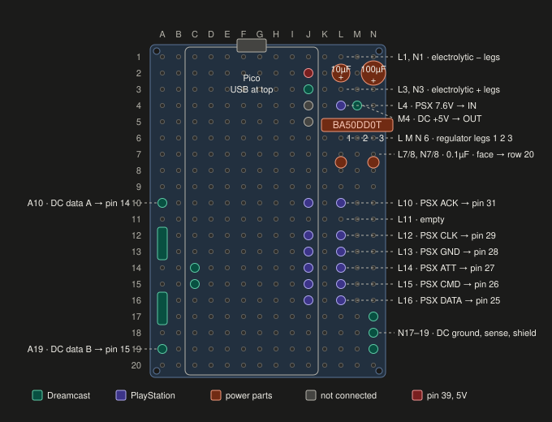
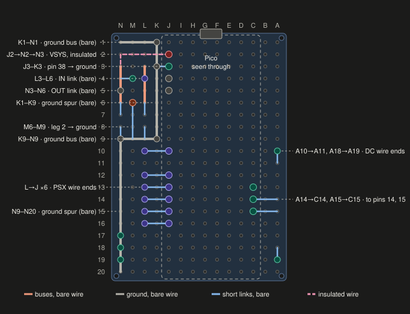

# Assembly

Soldering guide for building the adapter on a 14 × 20 hole double-sided
protoboard. For the circuit itself, see [wiring.md](./wiring.md).

| Component side | Solder side (mirrored) |
|---|---|
|  |  |

The diagrams are generated by [`board-layout.py`](./board-layout.py)
(`python docs/board-layout.py files`). If the diagrams and this guide ever
disagree, the script is correct.

## Board layout

Columns are A–N and rows are 1–20. The solder-side diagram is drawn mirrored,
as it looks with the board flipped over.

The Pico runs the full length of the board with USB at row 1. Its left pin row
is in column C (C1–C20 = pins 1–20) and its right pin row is in column J
(J1–J20 = pins 40–21). So pin 39 is J2, pin 38 is J3, and pins 31–25 are
J10–J16. Everything else goes in the margins: Dreamcast parts in column A,
power and PlayStation parts in columns K–N.

Notation: `A11–A14` means a part with legs in A11 and A14. `L3→L6` means a
wire or bent leg running along the underside from L3 to L6.

### Component side

| Holes | Part |
|---|---|
| A11–A14 | 10 Ω resistor, Data A |
| A15–A18 | 10 Ω resistor, Data B |
| A10 | Dreamcast Data A wire |
| A19 | Dreamcast Data B wire |
| L1 / L3 | 10 µF electrolytic, negative at L1, positive at L3 |
| N1 / N3 | 100 µF electrolytic, negative at N1, positive at N3 |
| L4 | PSX pin 3 (7.6V) wire |
| M4 | Dreamcast +5V wire |
| L6 / M6 / N6 | Regulator pins 1 (IN), 2 (GND), 3 (OUT). Printed face toward row 20 |
| L7–L8 | 0.1 µF ceramic, input side |
| N7–N8 | 0.1 µF ceramic, output side |
| L10 | PSX ACK |
| L11 | Empty |
| L12 | PSX CLK |
| L13 | PSX GND |
| L14 | PSX ATT |
| L15 | PSX CMD |
| L16 | PSX DATA |
| N17 / N18 / N19 | Dreamcast ground, sense and shield wires |

### Solder side

| Link | Purpose |
|---|---|
| K1→N1, K1→K9, K9→N9, N9→N20 | Ground: one net along row 1, down column K, along row 9, and down column N |
| J3→K3 | Pico pin 38 to ground |
| L3→L6 | Regulator input: 10 µF positive, 7.6V wire at L4, regulator pin 1 |
| N3→N6 | Regulator output: 100 µF positive, +5V wire via N4, regulator pin 3 |
| L7→L6, N7→N6 | Ceramics to input and output |
| L8→L9, N8→N9 | Ceramics to ground |
| M6→M9 | Regulator pin 2 to ground |
| M4→N4 | Dreamcast +5V to the output |
| J2→N2→N3 (insulated) | Pico pin 39 (VSYS) to the output. Crosses the ground spur at K2, so it must be insulated |
| L10→J10 … L16→J16 | PSX wires to Pico pins 31–25 |
| A10→A11, A18→A19 | Dreamcast data wires to the resistors |
| A14→C14, A15→C15 | Resistors to Pico pins 14 and 15 |

The ground spur in column K stops at K9. K10–K16 carry the PSX links across
and must not be connected to ground.

Watch for solder bridges where a ground pad sits next to a live one: K3/L3,
L7/L8, N7/N8, and the K spur next to J2 (VSYS). Rows 2–4 in columns K–N are
the most crowded area.

## Parts

- Raspberry Pi Pico with header pins at 1–4, 13–15, 25–31 and 36–39. Only
  14, 15, 25–29, 31, 38 and 39 are connected; the rest hold the Pico in place
- 2 × 10 Ω resistors
- 1 × 10 µF electrolytic capacitor
- 1 × 100 µF electrolytic capacitor (a 6.3 mm 47 µF fits inside the board
  edge; an 8 mm 100 µF overhangs it by about 2 mm)
- 2 × 0.1 µF ceramic capacitors
- ROHM BA50DD0T regulator
- Bare solid-core wire or trimmed component legs for links, and one short
  insulated wire for VSYS

## Order of work

Solder low parts before tall ones, since the board lies upside down while you
solder. Push cable wires through their holes before any bus is soldered over
them, and use the stripped end of each wire to form its own link. Where
several things meet at one pad, put them in together and solder that pad once.

Mark A1 on the component side before starting. Getting the orientation wrong
is the most likely mistake.

Tin the ends of stranded wires before pushing them through.

### 1. Resistors

1. Fit the 10 Ω resistors at A11–A14 and A15–A18 and solder them.
2. Trim A11 and A18 flush. Leave the A14 and A15 legs long underneath; they
   become the links to C14 and C15.

### 2. Power section

Columns K–N, rows 1–9, from the component side:

```
row   K    L     M     N
 1    ·   10µ−        100µ−
 2    ·    ·     ·     ·
 3    ·   10µ+        100µ+
 4    ·   7.6V  +5V    ·
 5    ·    ·     ·     ·
 6    ·   IN    GND   OUT      regulator pins 1 2 3
 7    ·   0.1         0.1
 8    ·   0.1         0.1
 9    ·    ·     ·     ·
```

3. **Regulator** at L6 / M6 / N6. Pin 1 is on the left when you look at the
   printed face with the legs pointing down, so the printed face goes toward
   row 20 and the tab toward row 1. Check against the datasheet before
   soldering. Stand it about 3 mm off the board. Solder M6 only, together with
   a bare wire from M6 to M9. Leave L6 and N6 for now.
4. **Ceramics** at L7–L8 and N7–N8. Underneath, bend the row 7 legs onto the
   regulator legs at L6 / N6, and the row 8 legs onto L9 / N9. Solder L7, L8,
   N7 and N8.
5. **7.6V wire** (PSX pin 3) through L4 from the component side, with about
   4 mm showing underneath. Don't solder it yet.
6. **10 µF**, positive in L3, negative in L1. Bend the positive leg along
   L3→L6, over the 7.6V wire at L4, ending at the regulator leg. Solder L3,
   L4, L5 and L6 (L6 joins the regulator, capacitor and ceramic legs). Bend
   the negative leg along L1→K1 and solder L1 and K1.
7. **100 µF**, positive in N3, negative in N1. Bend the positive leg along
   N3→N6 and solder N3, N5 and N6. Leave N4 unsoldered for the +5V wire. Bend
   the negative leg along N1→K1, over the 10 µF leg, and solder N1 and M1,
   then reflow L1 and K1.

If the two electrolytics touch, lean the 10 µF toward column K.

### 3. Pico

8. Fit the Pico with USB at row 1, pin 1 in C1 and pin 40 in J1. Solder C1
   and J10 first, check that it sits flat, then solder the rest. Rows 16–20
   have no pins; a dab of hot glue under that end is optional.

### 4. Underside links

9. **Ground spur K1→K9**, with the **J3→K3** link for pin 38. Solder K1, K3
   and K9. Keep clear of J2 (VSYS); a bridge there shorts 5V to ground.
10. **Row 9 ground bus K9→N9.** Solder L9, M9 and N9.
11. **Right-edge ground spur N9→N16.** Stop at N16; the Dreamcast ground wires
    go through N17–N19 first.
12. **Check:** pin 38 has continuity to L1, N1, M9, N16 and pin 28 (J13).
    Pin 39 to ground must be open.
13. **Resistor links** A14→C14 and A15→C15.

### 5. Cables

Each wire goes through its hole from the component side, and its stripped
end is bent along the underside to the pad listed.

14. **Dreamcast Data A** through A10, end to A11.
15. **Dreamcast Data B** through A19, end to A18.
16. **Dreamcast +5V** through M4, end to N4. Solder M4 and N4. Double-check
    that this wire is nowhere near columns A–C.
17. **Dreamcast ground, sense and shield** through N17, N18 and N19. Lay the
    last part of the ground spur, N16→N20, over their ends and solder N17,
    N18 and N19.
18. **PSX wires** through the L holes, each end bent across column K to its
    Pico pin:
    - ACK: L10 → J10 (pin 31)
    - CLK: L12 → J12 (pin 29)
    - GND: L13 → J13 (pin 28)
    - ATT: L14 → J14 (pin 27)
    - CMD: L15 → J15 (pin 26)
    - DATA: L16 → J16 (pin 25)

    Strip only about 8 mm so the insulation sits in the hole. L11 stays empty.
    The 7.6V wire is already in L4, and PSX pin 5 (3.3V) stays cut.
19. **Strain relief:** a zip tie around the PSX wires through M12 and M14, and
    another around the Dreamcast cable near row 20. Hot glue at the board edge
    also works.

### 6. Power-up

Flash the firmware and set the input to Dreamcast first (see Setup in the
[README](../README.md#setup)). With the console unplugged, this can be done
over USB at any point.

20. With USB unplugged and the VSYS link not fitted, plug into the console and
    power on. Measure against ground:
    - L6 (input): about 7.6V
    - N6 (output): 5.0V. If it reads anything else, stop and find the fault.

    Power off and unplug.
21. Fit the **insulated VSYS link** from J2 (pin 39) along row 2 to N3.
    Check that pin 39 has continuity to N6 and is open to pin 38.
22. Plug a Dreamcast controller into the adapter, plug the adapter into the
    console, and power on. The LED should show groups of blinks once the
    console starts reading the adapter (slow blinking means the controller
    isn't detected). Check that the BIOS menu responds, then try a game.
23. Plug in USB as well, with the console on, and check that nothing gets
    warm.

Don't leave USB plugged in while the adapter is in a console that's switched
off. See [wiring.md](./wiring.md#vsys-not-3v3).
