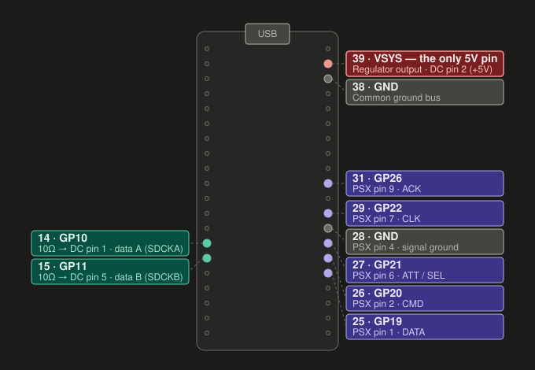
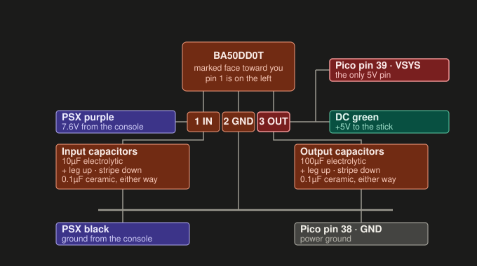

# Wiring

Electrical connections for the Dreamcast → PS1 adapter. For the protoboard
layout and soldering order, see [assembly.md](./assembly.md).



## Safety

- **Dreamcast pin 2 is +5V.** It connects to the regulator output and the Pico's
  VSYS pin only. It must never reach a GPIO; the RP2040 is not 5V tolerant.
- **PSX pin 5 is the console's 3.3V rail.** It is not used. Cut it short and
  insulate it properly. Taping it aside is not enough.
- **Identify every wire with a multimeter before soldering.** Cables differ,
  so work out which wire is which on your own cables.

All signal lines are 3.3V logic on both sides (the Maple bus idles at 3.3V and
the PS1 pad bus is 3.3V), so no level shifting is needed.

## Pin map

| Pico pin | GPIO | Connection | Via |
|---|---|---|---|
| 14 | GPIO10 | Dreamcast Data A (SDCKA) | 10 Ω |
| 15 | GPIO11 | Dreamcast Data B (SDCKB) | 10 Ω |
| 25 | GPIO19 | PSX pin 1, DATA | direct |
| 26 | GPIO20 | PSX pin 2, CMD | direct |
| 27 | GPIO21 | PSX pin 6, ATT | direct |
| 29 | GPIO22 | PSX pin 7, CLK | direct |
| 31 | GPIO26 | PSX pin 9, ACK | direct |
| 28 | GND | PSX ground | |
| 38 | GND | Common ground | |
| 39 | VSYS | Regulator 5V output | |

The PS1 pins (GPIO 19, 20, 21, 22, 26) are fixed in
`src/device_files/psx-device/psxSPI.pio`. The Maple pins are set by
`MAPLE_PIN_A` in `src/config.h`. Data B is always `MAPLE_PIN_A + 1`, so the
pair can be moved to any other free adjacent GPIOs.

Leave these free: GPIO 0/1 (UART debug console), 5–8, 16/17 and 18. The
firmware uses them in other modes.

## PlayStation side

Use a PS1/PS2 controller cable, for example one cut from an old DualShock. Pins
are numbered 1 to 9, left to right, looking at the face of the plug. Use
continuity mode to match each wire to its pin.

| PSX pin | Signal | Connect to |
|---|---|---|
| 1 | DATA | Pico pin 25 (GPIO19) |
| 2 | CMD | Pico pin 26 (GPIO20) |
| 3 | 7.6V | Regulator input |
| 4 | GND | Common ground |
| 5 | 3.3V | Not connected. Cut and insulate |
| 6 | ATT | Pico pin 27 (GPIO21) |
| 7 | CLK | Pico pin 29 (GPIO22) |
| 8 | (unused) | |
| 9 | ACK | Pico pin 31 (GPIO26) |

DATA and ACK don't need pull-up resistors. The console provides them.

## Dreamcast side

Use a Dreamcast controller extension cable and keep the female socket end.

### Dreamcast plug pinout

| DC pin | Signal |
|---|---|
| 1 | Data A (SDCKA) |
| 2 | +5V |
| 3 | GND |
| 4 | Sense (tied to ground) |
| 5 | Data B (SDCKB) |

### Identifying the socket wires

To work out which socket wire is which:

1. Cut the extension cable. You now have a male half and a female half.
2. Plug the male half into a powered-on Dreamcast and measure its bare wires
   against ground. +5V reads 5.0V, the two data lines read about 3.3V, and the
   ground wires read 0V.
3. Unplug it and connect the male half to the female half. Use continuity mode
   to find which female wire matches each male wire.
4. Write the mapping down before you unplug them.

Without a Dreamcast, you can probe the socket's contacts directly: use
continuity mode from each contact to the cut wires and match them to the
pinout above. The socket is the mirror image of the plug, so double-check
which side pin 1 is on.

Pins 3 and 4 are joined inside the Dreamcast, so both read as ground. Connect
both to ground, along with the cable shield if it has one.

If Data A and Data B end up swapped, the controller won't be detected. Both
lines are 3.3V behind 10 Ω, so swapping them back is safe.

### Socket connections

| Signal | Connect to |
|---|---|
| +5V | Regulator output and VSYS. Never a GPIO |
| Data A | 10 Ω → Pico pin 14 (GPIO10) |
| Data B | 10 Ω → Pico pin 15 (GPIO11) |
| GND | Common ground |
| Sense | Common ground |
| Shield | Common ground |

## Resistors

Fit a 10 Ω resistor in series with each Maple data line, at the Pico end.

They limit the current if the firmware and the controller ever drive a line in
opposite directions at the same time. Don't leave them out. If the bus is
unreliable, try 33 Ω instead. A Dreamcast uses 36 Ω here, but the Pico's
output drivers already add some resistance of their own.

No pull-ups are needed on the Maple lines. The RP2040's internal pull-ups are
enough. If you do have trouble, add 1 kΩ from each data line to 3V3 (Pico
pin 36). Don't use 10 kΩ; it's too weak for a 2 Mbps bus.

## Power

The PS1 controller port provides 3.3V and 7.6V but no 5V. A Dreamcast
controller needs 5V, so a regulator makes 5V from the 7.6V line.



```
 PSX pin 3 ──┬── 10µF ──┬── BA50DD0T ──┬── 100µF ──┬── DC +5V
 (7.6V)      │   0.1µF  │   1: IN      │   0.1µF   │
             │          │   2: GND     │           └── Pico pin 39 (VSYS)
             │          │   3: OUT     │
 PSX pin 4 ──┴──────────┴──────────────┴──────────────── common ground
 (GND)

 PSX pin 5 (3.3V) ── not connected
```

### Regulator

ROHM BA50DD0T, TO220FP-3 package, 2.54 mm pitch.

| Pin | Function |
|---|---|
| 1 | Input |
| 2 | Ground |
| 3 | Output (5V) |

It accepts 3–25V in and has a 450 mV dropout, so 7.6V in leaves plenty of
headroom. A 7805 drops about 2V and would be marginal here. TO220FP has an
isolated tab, so it can touch the enclosure. The adapter draws well under
150 mA, about 0.4 W in the regulator, so no heatsink is needed.

A linear regulator is used on purpose. A switching regulator would add noise
next to the Maple bus, and at this current efficiency doesn't matter.

### Capacitors

| Position | Value | Type |
|---|---|---|
| Input (pin 1 to pin 2) | 10 µF | Electrolytic |
| Input (pin 1 to pin 2) | 0.1 µF | Ceramic |
| Output (pin 3 to pin 2) | 100 µF | Electrolytic |
| Output (pin 3 to pin 2) | 0.1 µF | Ceramic |

The datasheet asks for at least 22 µF on the output; anything from 47 to
100 µF is fine. Keep the ceramics as close to the regulator pins as possible.

### VSYS, not 3V3

The 5V goes to VSYS, so the Pico's own regulator makes its 3.3V and the
console's 3.3V rail is left alone. USB can stay connected while the adapter
runs in a powered console (useful for serial debugging), because the Pico's
VBUS diode blocks backfeed.

Avoid having USB connected while the adapter is plugged into a console that
is switched **off**. That puts USB voltage on the regulator's output with
nothing on its input. Either unplug from the console when using USB, or fit a
1N5819 Schottky diode from the regulator's output to its input.

### Optional: resettable fuse

A resettable polyfuse (around 400 mA hold) in series with PSX pin 3, before
the input capacitors, will trip on a short before the console's internal
fuses do. A PS1's fuses (PS601/PS606) have to be desoldered to replace.

## Grounding

All grounds are joined: PSX pin 4, the Dreamcast ground, sense and shield
wires, regulator pin 2, the capacitor negative legs, and the Pico. All of the
Pico's GND pins are connected together on the board, so any of them works.

On the protoboard layout, everything except the PSX ground wire goes to one
ground bus tied to Pico pin 38. The PSX ground wire goes to pin 28.

## Before powering on

1. Build and test the power section first, with the regulator output not
   yet connected to VSYS. Plug into the console, power on, and check the
   regulator output reads 5.0V.
2. Check continuity from every soldered GPIO to the +5V line and to the 7.6V
   line. Both must be open.
3. Check that PSX pin 5 (3.3V) is cut and insulated.
4. Only connect or disconnect the adapter with the console off.
